
Side-Channel Countermeasures for Adam’s Bridge Accelerator

Version 2.0

**Note:** This document will be updated soon and will include the countermeasure implementation details.

See NIST FIPS 204 document for the pseudo codes and symbols. 

# Threat Model for Securing Adams Bridge Against Side-Channel Attacks

## Introduction

In this threat model, the document outlines the potential vulnerabilities and the measures taken to secure the hardware implementation of the Crystal Dilithium post-quantum cryptographic algorithm against side-channel attacks. The document distinguishes between profiled and non-profiled attacks, identify the private and secret key values, and separate timing side-channel attacks from other physical attacks such as power, EM, and acoustic attacks. This model specifically addresses the operations involved in key generation and signature generation, excluding the verification routine which does not involve secret data processing.

## Attack Vectors

### Profiled Attacks

**Definition**: Attacks where the adversary has prior knowledge or can build a profile of the target device’s behavior under various conditions. This attack has two phases: profiling and attacking. First, the attacker has physical access to the identical device and can configure it with known keys to capture side-channel traces. Therefore, the adversary can capture multiple measurements to create templates corresponding to known keys or intermediate values. 

Second, it is assumed that the adversary has sufficient knowledge about the details of the target implementation, i.e., the adversary downloads and inspects the publicly available RTL. The adversary captures one or multiple similar traces that are obtained from the device while it is executing the same inputs. The captured trace(s) go through a matching process where they are compared with pre-constructed templates, returning the label of the closest template.

**Targets**: Extraction of secret keys or private values by comparing the observed behavior with pre-constructed profiles.

### Non-Profiled Attacks

**Definition**: Attacks where the adversary does not have prior knowledge or profiles and relies solely on observed behavior during cryptographic operations. The example is Correlation Power Analysis (CPA). The attacker collects many side-channel traces during the execution of cryptographic operations. These traces are then statistically analyzed to find correlations between the side-channel measurement and hypothesized intermediate values, allowing the attacker to deduce the secret keys or private values. These attacks ideally work when the targeted device is configured with only a fixed secret key, with only one series of non-adaptive observations on operations using that single key.

Targets: Direct extraction of private or secret values from real-time observations without prior profiling. This strategy can be particularly effective against operations with data-dependent power consumption or electromagnetic emissions.

**Note**: *Non-profiled attacks are considered more powerful than profiled attacks since they can eliminate the effect of noise. The success rate is a matter of the number of collected traces rather than solely relying on platform conditions, and therefore their countermeasures are more limited and expensive*

**Note**: *This threat model covers the side-channel attack vectors for the deterministic version of Crystal Dilithium post-quantum cryptographic algorithm. Since the deterministic version covers all profiled and non-profiled attack vectors of hedged, this threat model covers superset of the hedged version of Crystal Dilithium post-quantum cryptographic algorithm. For simplicity, this document illustrates the main difference between hedged and deterministic version of the algorithm as given by: the hedged version generates Ro prime with a fresh randomness for each signature. As a result, the private intermediate values derived from this randomness are not considered for non-profiled attack.*

## Private and Secret Values

### Secret Keys

All secret keys are considered private and must be protected from both profiled and non-profiled attacks.

### Private Values

Private values include intermediate variables that can provide information about the secret keys if recovered. Although private values are not always secret, their recovery can reveal significant information about the secret keys.

## Threat Coverage

### Physical Side-Channel Attacks

**Types Covered:** Power analysis, electromagnetic (EM) analysis, and acoustic analysis.

**Scope:** All operations involved in key generation and signature generation.

**Countermeasures:** Combined masking and shuffling techniques to obscure power and EM signatures, and careful design to mitigate acoustic leakage.

### Timing Side-Channel Attacks

**Scope**: All operations in key generation and signature generation.

**Objective**: Ensure no variation in timing of any externally visible events that could reveal private values.

**Approach**: Implement constant-time execution for operations involving private values, while allowing non-constant time execution for other operations that do not involve private values.

## Key Generation

### Timing Side-Channel Attack Mitigation

The key generation implementation does not have any operations whose execution time varies based on private values. Ensures that no information about private values is leaked through timing variations.

### Physical Side-Channel Attack Mitigation

The key generation operation does not have a non-profiled attack vector since its nature is inherently secure against CPA-style attacks. This is because non-profiled attacks require multiple traces captured while constant secret or private values are being processed. Additionally, the attacker needs to either control or observe different inputs or outputs such that the side-channel measurement can be differentiated. Although key generation can be executed multiple times to satisfy the first condition of CPA, the second condition is not satisfied because each execution works with the same inputs and generates the same output. If the attacker needs to satisfy the second condition and feed the key generation with different inputs, this condition dissatisfies the first condition of CPA since the secret changes for each different input.

## Signature Generation

### Timing Side-Channel Attack Mitigation

Signature generation involves several steps where private values are processed. To mitigate timing side-channel attacks, we focus on ensuring that the execution time of these operations does not vary based on private values. We have timing variation only in signature validity checks. Validity check mechanism’s timing side-channel analysis is given by:

#### *Validity Checks:*

**First Validity Check**: This check involves conditions based on z and r0 (see FIPS 204:Algorithm 2:21-23). These checks are performed to ensure that the time taken does not vary based on the values of z and r0. If a condition fails, the signature routine iterates again. In our case, the implementation does not return a rejected signature and does not write the rejected signature to any location accessible by firmware.

The threat model assumes that having information about the result of the first validity check reveals partial information about the boundaries of r0. Specifically, it indicates whether r0 is less than gamma2 \- beta. Although r0 is a private polynomial, knowing partial information about r0 does not reveal the secret. This is because r0 is generated through an operation involving subtraction and multiplication.

The operation consists of one secret polynomial undergoing subtraction with a polynomial that is the product of a secret and public information. This multiplication blinds the public information, making the product a private value. Consequently, r0 is a product of two private values. Even though knowing r0 would require solving an NP-hard problem to recover the secret, the execution time of the validity check only reveals partial information about r0.

**Second Validity Check:** The second validity check also involves two conditions (see FIPS 204:Algorithm 2:27). The second condition, when true, is public. The first condition involves ct0, which is a blind value due to the multiplication. However, knowing the boundaries of this product can reveal information about the private value.

To prevent leaking coefficient-wise information about ct0, our design performs a full check of ct0 before returning the validity check result, rather than returning immediately after the first rejected coefficient. This approach ensures that the attacker cannot gain detailed coefficient-wise information about ct0. Instead, the attacker only knows that at least one coefficient of ct0 is less than gamma2.

By performing a full check, the design prevents timing variations that could reveal partial information about the private value ct0. The attacker is forced to solve the algebraic equation involving ct0 with the limited information that at least one coefficient is less than gamma2, making it significantly harder to extract useful private information.

### Physical Side-Channel Attack Mitigation

The threat model assumes that signature generation is vulnerable to non-profiled attack vectors. This is because an attacker can sign multiple different messages with a constant secret, allowing them to perform side-channel analysis. Therefore, the document focuses on the operations where a known message (c) or a known matrix (A) interacts directly and purely with secret or private values:

Identified Vulnerable Operations:

Point-wise Multiplication: Operations involving cs1, cs2, ct0, and Ay.

To mitigate these vulnerabilities, the following strategies are employed:

* Masking Countermeasures: Applied specifically to Point-wise Multiplication (PWM) operations. These countermeasures ensure that the output values are blinded, as the public value c is multiplied with secrets such as t0, s1, and s2. In addition to the point-wise multiplication, the first stage of inverse-NTT is also masked. 
* Special Case for A and y Multiplication: Although A is publicly known, the attacker cannot update A without updating the secret keys. Consequently, the multiplication of A with y is not subject to CPAs if A remains constant for given secret key. Therefore, Version 1.0 does not employ masking countermeasures for the A·y operation. However, this operation will be masked in future versions.
* Shuffling Techniques: Employed for other operations that are required before or after PWM multiplication, including NTT, pointwise addition, and subtraction. Shuffling helps to randomize the order of these operations, further obscuring any potential side-channel leakage. Additionally, the norm check operation is also protected using shuffling, as it can reveal information about the rejection process during signature generation. By randomizing the coefficient order, shuffling mitigates the risk of identifying which specific coefficient causes the signature rejection.

**Note**: Masking and shuffling require randomness entropy, which is obtained using PRNGs assumed to be anti-tampered.

### Operations Protected with Masking

Point-wise multiplication and the first state of inverse NTT.

### Operations Protected with Hiding

NTT, point-wise addition and point-wise subtraction.

## ML-KEM Decapsulation Usage Model

The ML-KEM side-channel countermeasures assume the **ephemeral decapsulation-key usage model** defined in [AdamsBridge_MLKEM.md — Usage Model Restriction: Decapsulation Key Reuse](./AdamsBridge_MLKEM.md#usage-model-restriction-decapsulation-key-reuse).

Multi-query chosen-ciphertext side-channel attacks need many decapsulations under the same decapsulation key. These include plaintext-checking and decryption-failure oracle attacks on the Fujisaki–Okamoto re-encryption and comparison. Such attacks are **outside the threat model** covered by this document.

They are mitigated by the usage model, which the integrator (firmware or protocol layer) enforces:
- single-use decapsulation keys; or
- bounded reuse with key rotation when a decapsulation fails.

Consistent with FIPS 203 implicit rejection, the hardware neither tracks key reuse nor exposes a decapsulation-failure indication.

# Attack Vectors

| Attack Type | Definition & Assumptions | Targets | Countermeasures |
| :---- | :---- | :---- | :---- |
| Profiled Attacks | Adversary has prior knowledge or can build a profile of the target device’s behavior. The attack has profiling and attacking phases. | Extraction of secret keys or private values by comparing observed behavior with pre-constructed profiles. | Masking and hiding techniques. |
| Non-Profiled Attacks | Adversary relies solely on observed behavior during cryptographic operations (e.g., CPA). | Direct extraction of private or secret values from real-time observations without prior profiling. | Masking countermeasures; use of PRGNs for randomness entropy. |

# Private and Secret Values

| Value Type | Description | Protection Requirements |
| :---- | :---- | :---- |
| Secret Keys | All secret keys are considered private and must be protected from non-profiled attacks. | Must be protected from any form of leakage; ensure no direct correlation with physical measurements. |
| Private Values | Intermediate variables that can reveal significant information about secret keys if recovered. | Protect against non-profiled attacks; apply masking and shuffling. |

# Threat Coverage

| Attack Type | Scope | Countermeasures |
| :---- | :---- | :---- |
| Physical Side-Channel Attacks | Power analysis, electromagnetic (EM) analysis, and acoustic analysis for all key generation and signature generation operations. | Combined masking and shuffling techniques; careful design to mitigate acoustic leakage. |
| Timing Side-Channel Attacks | All operations in key generation and signature generation. | Constant-time execution for operations involving private values; ensure no timing variations. |

## Legacy Empirical Validation (v1.0)

Version 1.0 presents TVLA results only for the case where the shuffling countermeasure is enabled. The results show that the shuffling countermeasure reduces the t-score by 100x compared to the unprotected design. However, leakage is still observed after 55K captured traces.

### Experiment Setup:
- **Target Physical Device**: CW310 Bergen Board with Kintex K410T FPGA, executing the hardware design for side-channel evaluation. The FPGA board has a designated SMA port that provides the power drop across a shunt resistor.
- **Oscilloscope**: PicoScope 6428E-D, capable of capturing up to 10 GS/s.
- **FPGA Operating Frequency**: 10 MHz.
- **Oscilloscope Sampling Frequency**: 156 MHz.

<!-- **Figure 1**: NTT and Point-wise multiplication TVLA results for 54,000 traces, showing leakage after 55,000 traces.

Although Version 1.0 includes masking countermeasures, this report does not present TVLA results for masking countermeasures. These results will be provided in future releases. -->

# Side-Channel Analysis (SCA) — TVLA Results for ML-KEM & ML-DSA

## Side-Channel Leakage Evaluation — Adams Bridge 2.2

We employ Test Vector Leakage Assessment (TVLA) to experimentally evaluate first-order side-channel leakage in the Adams Bridge 2.2 hardware architecture. All experiments are conducted on a physical FPGA platform configured to reproduce the datapath, randomness usage, and control sequencing of the hardware implementation.

Our evaluation focuses on security-critical arithmetic operations: the Number Theoretic Transform (NTT), inverse NTT (INTT), point-wise multiplication (PWM), and point-wise addition (PWA). We also evaluate the NTT-domain flow of ML-DSA signing to examine the transition from masked arithmetic to recombined signature processing.

The results below describe the 2.2 evaluation and supersede the earlier operation-level TVLA results. The preceding v1.0 empirical validation is retained as historical context, not as the experimental setup for this evaluation.

### Experimental Setup

Power measurements are collected using the SCA-specific version of the CW310 Bergen board, equipped with a Kintex-7 XC7K410T FPGA. This variant is designed to facilitate high-fidelity power measurements and improve the observability of side-channel leakage.

The board provides a dedicated SMA connector for power measurements through an onboard shunt resistor. The FPGA operates at 10 MHz, a reduced frequency selected to improve cycle-level visibility of power consumption and minimize temporal overlap between consecutive operations. Power traces are acquired using a PicoScope 6424E oscilloscope at a sampling rate of 156.25 MS/s.

We employ fixed-versus-random TVLA, comparing power traces collected using fixed and randomized secret values. Unprotected implementations are evaluated using 100,000 traces, whereas protected operation-level evaluations use 1,000,000 traces.

First-order Welch's t-test is applied at each sample to identify statistically significant differences between the two trace populations. The conventional screening threshold is |t| = 4.5. A threshold crossing indicates a detectable difference between the populations; it does not, on its own, establish an exploitable key-recovery attack.

| Parameter | Configuration |
|---|---|
| FPGA Board | CW310 Bergen (SCA-specific version) |
| FPGA | Kintex-7 XC7K410T |
| Oscilloscope | PicoScope 6424E |
| FPGA Frequency | 10 MHz |
| Sampling Frequency | 156.25 MS/s |
| Statistical Test | Fixed-versus-random first-order Welch's t-test |
| Statistical Threshold | ±4.5 |
| Unprotected Operation-Level Evaluation | 100,000 traces |
| Protected Operation-Level Evaluation | 1,000,000 traces |

In the figures, the horizontal axis denotes samples within the captured operation window, not the number of traces. The blue dashed lines mark the thresholds of +4.5 and −4.5. The unprotected and protected plots use different vertical scales; comparisons should therefore be made using the t-score values and threshold crossings rather than the visual amplitude alone.

### Unprotected ML-DSA Implementation

The unprotected ML-DSA implementation is evaluated with masking, shuffling, and the PRNG disabled.

All four evaluated arithmetic operations exhibit t-scores far beyond the statistical threshold of |t| = 4.5 using 100,000 power traces. The NTT exhibits repeated leakage peaks throughout execution, while the INTT shows pronounced positive and negative excursions. The PWM and PWA operations reach t-scores of approximately 300.

These results demonstrate substantial first-order leakage in the unprotected implementation and provide a baseline for comparison with the protected configuration.

#### NTT — Unprotected

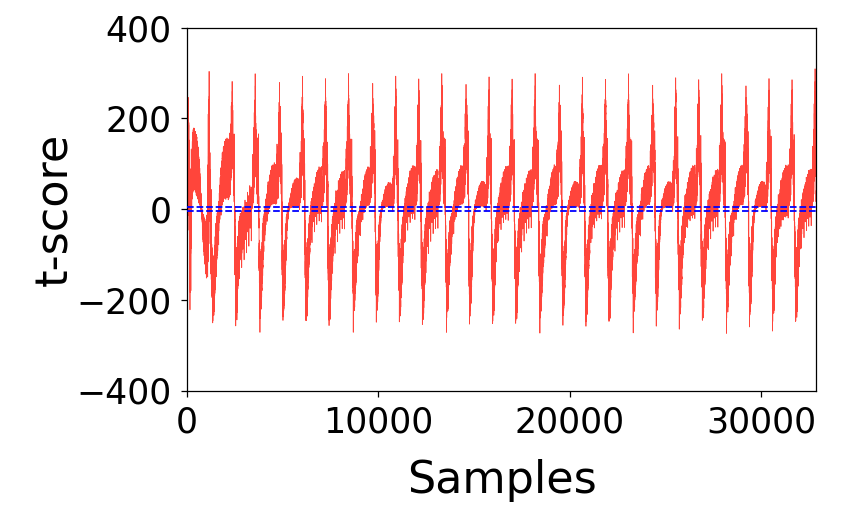

#### INTT — Unprotected

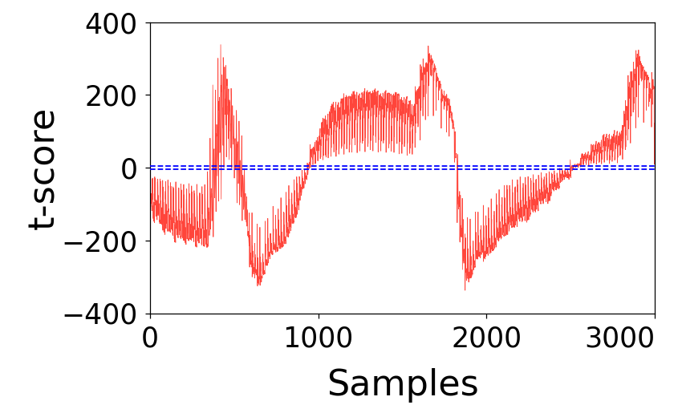

#### PWM — Unprotected

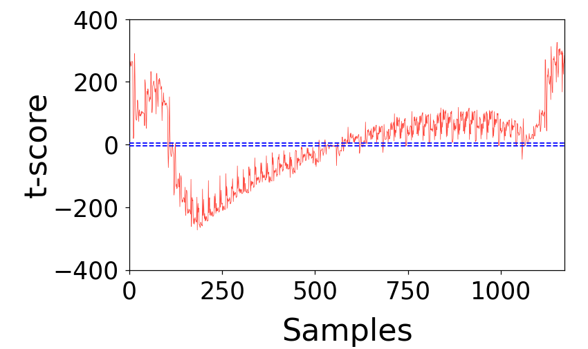

#### PWA — Unprotected

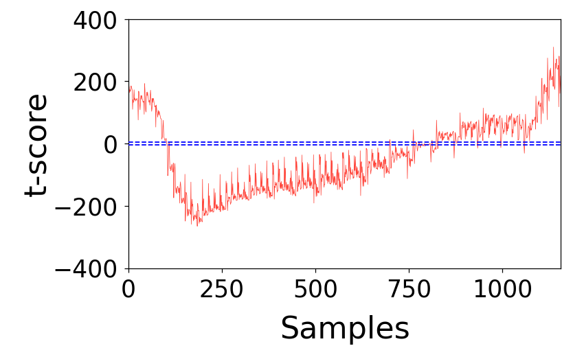

**Figure 1.** First-order TVLA results for the unprotected ML-DSA implementation, shown in order: (a) NTT, (b) INTT, (c) PWM, and (d) PWA. Using 100,000 power traces, the t-scores exceed the thresholds of +4.5 and −4.5 across all evaluated operations, indicating statistically significant first-order leakage.

### Protected ML-DSA Implementation

The protected ML-DSA implementation is evaluated with masking and shuffling enabled and randomness supplied by the on-chip PRNG. Each operation is evaluated using 1,000,000 power traces.

For NTT, INTT, PWM, and PWA, the t-scores remain within the statistical thresholds throughout the evaluated execution windows. No statistically significant first-order leakage is detected in these protected arithmetic operations under the tested conditions, despite using ten times as many traces as the unprotected baseline.

#### NTT — Protected

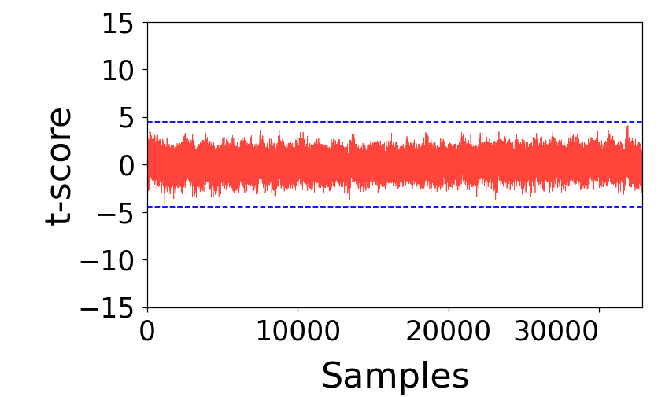

#### INTT — Protected

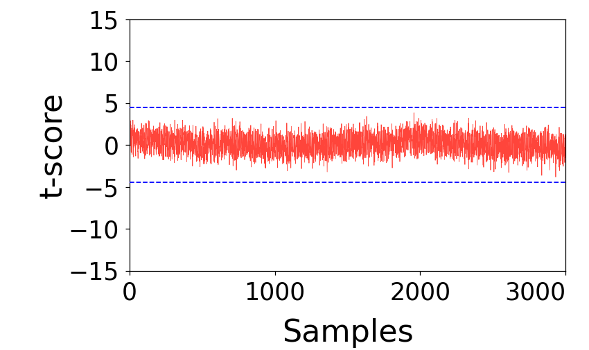

#### PWM — Protected

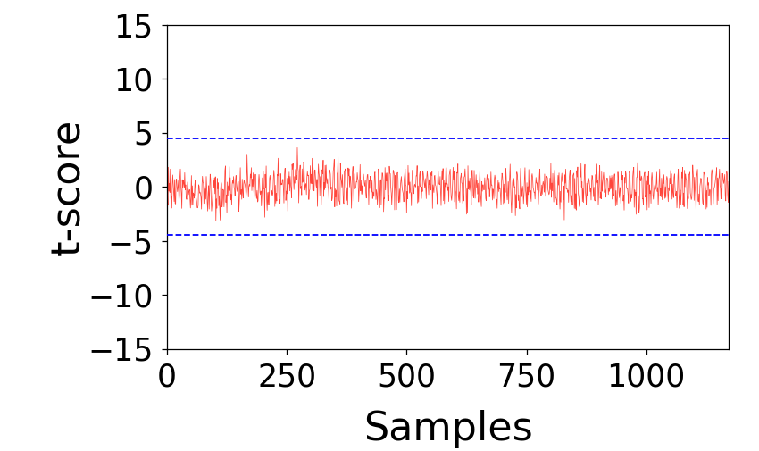

#### PWA — Protected

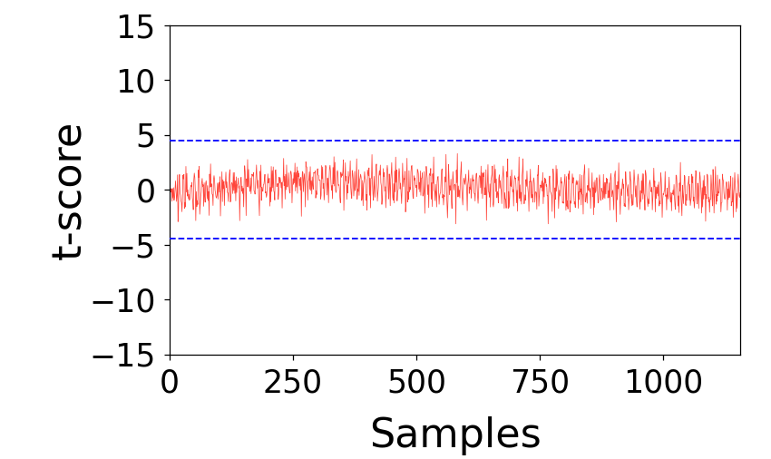

**Figure 2.** First-order TVLA results for the protected ML-DSA implementation using one million power traces, shown in order: (a) NTT, (b) INTT, (c) PWM, and (d) PWA. The t-scores remain within ±4.5 across the evaluated operation windows, indicating no statistically significant first-order leakage under the tested conditions.

### Protected ML-KEM Implementation

The protected ML-KEM implementation is also evaluated using first-order fixed-versus-random TVLA. The evaluation covers NTT, INTT, PWM, and PWA, with 1,000,000 power traces for each operation.

The supplied operation-level plots show t-scores remaining within ±4.5 throughout the displayed windows. No statistically significant first-order leakage is observed in these protected arithmetic measurements under the tested conditions. These results are operation-level evidence, not an evaluation of every step of ML-KEM decapsulation.

#### NTT — Protected

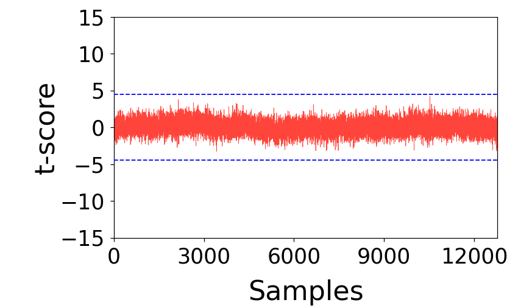

#### INTT — Protected

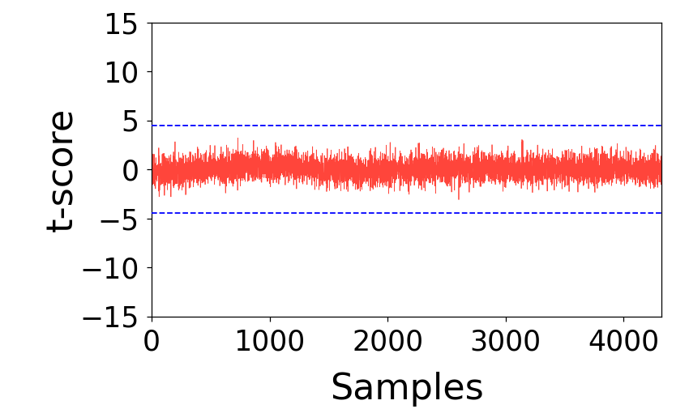

#### PWM — Protected

#### PWA — Protected

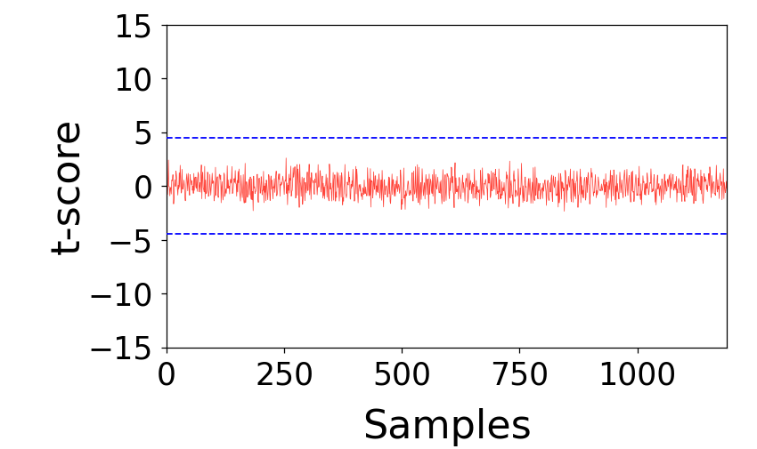

**Figure 3.** First-order TVLA results for the protected ML-KEM implementation using one million power traces, shown in order: (a) NTT, (b) INTT, (c) PWM, and (d) PWA. The blue dashed lines represent ±4.5; the plotted t-scores remain within these thresholds.

### ML-DSA NTT-Domain Flow Evaluation

To evaluate the masking boundary rather than only isolated operations, we also perform TVLA on a continuous sequence of the protected ML-DSA signing flow, from the forward NTT of the shares to signature encoding.

Throughout NTT, PWM, INTT, and PWA, the two shares are processed by two independently shuffled NTT engines. The reported t-scores remain within the statistical thresholds during these protected arithmetic operations.

During the norm check, which operates on recombined coefficients of the signature component `z`, the reported t-scores remain close to the statistical thresholds. Significant excursions appear during SIGENC, which encodes and outputs the recombined signature component `z`.

For an accepted signature, `z` is part of the public output. Since `z` is fixed in one population of this fixed-versus-random test and random in the other, data-dependent leakage during its encoding is expected. Such leakage does not, by itself, indicate disclosure of secret-dependent information beyond the public signature. This interpretation does not extend to rejected candidates or other intermediate values that are not released as public outputs.

These observations support the effectiveness of the masking boundary across the evaluated NTT-domain arithmetic sequence. They also demonstrate the importance of distinguishing leakage from protected secret-dependent computations from expected data-dependent leakage associated with public outputs. Near-threshold behavior at the norm check should be assessed separately rather than treated as evidence that all recombined processing is leakage-free.

The continuous-flow observations are reported qualitatively here; a corresponding flow plot and trace count are not included in this update.

### Summary of Adams Bridge 2.2 Results

| Algorithm | Configuration | Operation | Power Traces | TVLA Observation |
|---|---|---|---:|---|
| ML-DSA | Unprotected | NTT | 100,000 | Significant first-order leakage |
| ML-DSA | Unprotected | INTT | 100,000 | Significant first-order leakage |
| ML-DSA | Unprotected | PWM | 100,000 | Significant first-order leakage |
| ML-DSA | Unprotected | PWA | 100,000 | Significant first-order leakage |
| ML-DSA | Masking + Shuffling | NTT | 1,000,000 | No significant first-order leakage detected |
| ML-DSA | Masking + Shuffling | INTT | 1,000,000 | No significant first-order leakage detected |
| ML-DSA | Masking + Shuffling | PWM | 1,000,000 | No significant first-order leakage detected |
| ML-DSA | Masking + Shuffling | PWA | 1,000,000 | No significant first-order leakage detected |
| ML-KEM | Protected | NTT | 1,000,000 | No significant first-order leakage observed in supplied plot |
| ML-KEM | Protected | INTT | 1,000,000 | No significant first-order leakage observed in supplied plot |
| ML-KEM | Protected | PWM | 1,000,000 | No significant first-order leakage observed in supplied plot |
| ML-KEM | Protected | PWA | 1,000,000 | No significant first-order leakage observed in supplied plot |
| ML-DSA | Protected NTT-domain flow | NTT / PWM / INTT / PWA | Not reported | No significant first-order leakage reported in protected arithmetic |
| ML-DSA | Recombined processing | Norm check | Not reported | Reported t-scores close to statistical thresholds |
| ML-DSA | Signature encoding | SIGENC | Not reported | Reported leakage consistent with public signature component `z` |

### Security Interpretation

The unprotected ML-DSA implementation exhibits substantial first-order side-channel leakage across all evaluated arithmetic operations. In contrast, the protected ML-DSA measurements show no statistically significant first-order leakage in the evaluated NTT, INTT, PWM, and PWA windows using one million power traces. The protected ML-KEM operation-level plots likewise remain within the first-order TVLA thresholds at one million traces.

The continuous ML-DSA NTT-domain evaluation further indicates that the shares remain protected during the evaluated arithmetic sequence, while significant data-dependent leakage becomes observable during signature encoding. Interpreting this boundary requires accounting for which values are actually released in an accepted public signature.

These results provide empirical evidence of the effectiveness of the implemented countermeasures against first-order leakage under the evaluated conditions. However, first-order TVLA does not constitute a formal security proof and does not exclude higher-order leakage, alternative side-channel attack strategies, or leakage outside the evaluated computation regions. FPGA power measurements do not establish equivalent leakage behavior on other physical platforms or for other measurement modalities.

The ML-KEM results do not change the [ephemeral decapsulation-key usage-model restriction](./AdamsBridge_MLKEM.md#usage-model-restriction-decapsulation-key-reuse). Resistance to multi-query chosen-ciphertext side-channel attacks under a reused decapsulation key remains outside the stated threat model.

### Change Log

- **v2.2 (2026):** Updated the experimental setup and added first-order TVLA evaluations of unprotected and protected ML-DSA NTT, INTT, PWM, and PWA operations. Added protected ML-KEM operation-level measurements and the reported ML-DSA NTT-domain flow evaluation, including interpretation of leakage during public signature encoding and limitations of the evaluated scope.
- **v1.2:** Added ML-KEM decapsulation usage-model scope.
- **v1.1 (2025-08-19):** Added ML-KEM/ML-DSA PWM, masking and shuffling evaluations, INTT TVLA, and leakage observations.
- **v1.0:** Reported NTT and PWM results with shuffling enabled.

---

## Formal Validation
Unlike other SCA countermeasures, masking is a provable countermeasure. It can be formally verified using an accepted simulation and probing model. Boolean domain-oriented masking (DOM) AND gates or arithmetic DOM multiplier gadgets are constructed as building blocks for implementing masking countermeasures. 

DOM serves as a lower bound for any ISW-based multiplication gadget, although it does not provide composability guarantees. Consequently, our implementation is not formally proven to be secure under the robust probing model.
